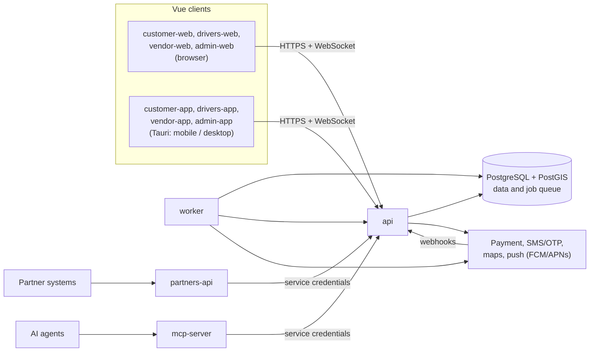

# Technical Specification

Status: Draft | Owner: @bankole2000 | Version: 0.4 | Last updated: 2026-11-27
References: FEATURES.md, PRD.md, DESIGN.md
<!-- review:focus ADR-008, "Identity and sessions", "users, sign_in_codes and sessions" -->

## Architecture overview
Proposed (ADR-001 to ADR-007). All eight client apps use one Vue UI stack. The four web apps run in the browser. The four installed apps wrap the same kind of Vue UI in Tauri for Android, iOS and, for admin-app and vendor-app, desktop. Every client calls `api`, the only owner of the database. `partners-api` and `mcp-server` are thin Rust services. They authenticate their own callers (partner API keys, agent connections) and call `api` with service credentials, so business rules live in one place. `worker` runs the timed and background work: order acceptance timeouts, driver offers, notifications, payout calculation and partner webhooks. It takes jobs from a queue in PostgreSQL.

Live tracking (FR-010, FR-024) goes over WebSockets from `api`. Driver positions (R-10) are written through `api`. Nearest-store sourcing (FR-006) and nearest-driver dispatch (FR-021) are PostGIS nearest-neighbour queries.

## Components
One row per deployable app in `apps/`, per shared package in `packages/`, and for `infra/` if used. App names match folder names, `app:` labels and release tags. Kinds: web client, mobile client, desktop client, server/API, worker, shared package, infrastructure.

| Component | Path | Kind | Stack and version | Deploys to | Owner | Requirements |
|---|---|---|---|---|---|---|
| customer-web | apps/customer-web | Web client | Vue 3 + TypeScript SPA built with Vite (Vue Router, Pinia), see ADR-004; may move to Nuxt if SEO becomes important | {{hosting}} | @bankole2000 | {{FR IDs}} |
| customer-app | apps/customer-app | Mobile client | Tauri 2 shell (Rust) with a Vue 3 + TypeScript UI, see ADR-005; minimum Android {{version}}, iOS {{version}} | {{App Store / Google Play}} | @bankole2000 | {{FR IDs}} |
| drivers-web | apps/drivers-web | Web client | Vue 3 + TypeScript SPA built with Vite (Vue Router, Pinia), see ADR-004 | {{hosting}} | @bankole2000 | {{FR IDs}} |
| drivers-app | apps/drivers-app | Mobile client | Tauri 2 shell (Rust) with a Vue 3 + TypeScript UI, see ADR-005; minimum Android {{version}}, iOS {{version}}; background location and push depend on the M0 spike | {{App Store / Google Play}} | @bankole2000 | {{FR IDs}} |
| admin-app | apps/admin-app | Mobile client, Desktop client | Tauri 2 shell (Rust) with a Vue 3 + TypeScript UI, see ADR-005; minimum Android {{version}}, iOS {{version}}, Windows {{version}}, macOS {{version}} | {{App Store / Google Play; desktop download or store}} | @bankole2000 | {{FR IDs}} |
| admin-web | apps/admin-web | Web client | Vue 3 + TypeScript SPA built with Vite (Vue Router, Pinia), see ADR-004 | {{hosting}} | @bankole2000 | {{FR IDs}} |
| api | apps/api | Server/API | Rust (stable, pinned in `rust-toolchain.toml`), axum on tokio, sqlx, PostgreSQL with PostGIS; OpenAPI generated with utoipa, see ADR-003 and ADR-006 | {{hosting}} | @bankole2000 | {{FR IDs}} |
| worker | apps/worker | Worker | Rust, sharing crates with api; jobs from a PostgreSQL queue, see ADR-007 | {{hosting}} | @bankole2000 | {{FR IDs}} |
| vendor-web | apps/vendor-web | Web client | Vue 3 + TypeScript SPA built with Vite (Vue Router, Pinia), see ADR-004 | {{hosting}} | @bankole2000 | {{FR IDs}} |
| vendor-app | apps/vendor-app | Mobile client, Desktop client | Tauri 2 shell (Rust) with a Vue 3 + TypeScript UI, see ADR-005; minimum Android {{version}}, iOS {{version}}, Windows {{version}}, macOS {{version}} | {{App Store / Google Play; desktop download or store}} | @bankole2000 | {{FR IDs}} |
| partners-api | apps/partners-api | Server/API | Rust, axum; OpenAPI generated with utoipa; also serves the developer docs (S-15) | {{hosting}} | @bankole2000 | {{FR IDs}} |
| mcp-server | apps/mcp-server | Server/API | Rust, official MCP Rust SDK (`rmcp`) | {{hosting}} | @bankole2000 | {{FR IDs}} |
| api-contract | packages/api-contract | Shared package | OpenAPI 3.1 spec generated from api, plus a generated TypeScript client (openapi-typescript, openapi-fetch) | Not deployed | @bankole2000 | — |
| partners-api-contract | packages/partners-api-contract | Shared package | OpenAPI 3.1 spec generated from partners-api; the public reference | Not deployed | @bankole2000 | — |
| mcp-contract | packages/mcp-contract | Shared package | Snapshot of the MCP tool schemas (JSON Schema) | Not deployed | @bankole2000 | — |
| ui | packages/ui | Shared package | Vue components and design tokens shared by every client | Not deployed | @bankole2000 | — |
| domain | packages/domain | Shared package | Rust crate: domain types and rules shared by api, worker, partners-api and mcp-server | Not deployed | @bankole2000 | — |
| infra | infra/ | Infrastructure | OpenTofu, see ADR-002 | {{cloud accounts / environments}} | @bankole2000 | — |

## Local development
Defaults that avoid the usual clashes on a developer machine; change them only with a reason.
- **Ports:** uncommon ones, so the apps don't collide with other local tools (3000, 5173, 8000 and 8080 are often taken): api 18082; local PostgreSQL 15482 (`docker-compose.yml`); web dev servers 13001 to 13004. Record each app's port in its `.env.example`.
- **Host:** use `127.0.0.1`, not `localhost`, in URLs and bind addresses. `localhost` can resolve to IPv6 first, which adds a delay to every database connection on some systems and makes some dev servers listen on IPv6 only.
- **Databases and other services** run in `docker-compose.yml` (committed) with trust authentication on `127.0.0.1` for local use and CI only, so no password sits in the repository. Each developer's extra services (caches, queues, other databases) go in a gitignored `docker-compose.override.yml`, which Compose loads automatically; commented-out services there cost nothing until needed. Turn off automatic restarts for local containers.
- **CORS:** each server reads the allowed client origins from configuration (e.g. `API_CORS_ORIGINS`), with defaults for every local client: the web dev server and the desktop and mobile shells.

## Repository and workspace
- Monorepo tooling: see ADR-001. There are two workspaces at the root and one task runner across both:
  - **pnpm workspaces** for the Vue apps and the TypeScript packages (`packages/ui`, `packages/api-contract` client).
  - **A Cargo workspace** for the Rust apps (`apps/api`, `apps/worker`, `apps/partners-api`, `apps/mcp-server`), each Tauri app's `src-tauri` crate and the Rust packages (`packages/domain`).
  - **Turborepo** runs tasks across both. Each Rust app has a small `package.json` whose scripts call `cargo`, so `turbo run test --filter=<app>` works the same for every app.
- Dependency rules: apps may depend on packages; packages never depend on apps; apps never import from another app's folder.
- Code style:
  - Rust: `rustfmt`, and `clippy` with warnings as errors.
  - TypeScript and Vue: ESLint (with `eslint-plugin-vue`) and Prettier, typechecked with `vue-tsc`.
- Generated code is committed, and each generator writes its own output file:
  - The OpenAPI specs in `packages/api-contract` and `packages/partners-api-contract` come from a binary in each server (`--out <file>`).
  - The TypeScript client comes from openapi-typescript (`-o <file>`).
  - CI fails when any of these is out of date.
- Toolchains are pinned: `rust-toolchain.toml`, `.nvmrc` and `packageManager` in the root `package.json`.

Commands are listed in the README [Commands](../README.md#commands) section, not here.

## Modules
Significant modules within each component.

| Component | Module | Responsibility | Dependencies | Requirements |
|---|---|---|---|---|
| {{Component}} | {{Module}} | {{Purpose}} | {{Dependencies}} | FR-001 |

## Domain and data model
Start from the resources (R-) in FEATURES.md: each stored resource becomes an entity, "Belongs to" becomes a relationship, and derived resources become queries or views. The users (U-) and the actions each may take (the coverage matrix) become the roles and permissions.

api owns the database; other components go through its API. Migrations are in `apps/api/migrations/`.

- **users, sign_in_codes and sessions** (R-30, ADR-008): `users` is one row per person (a verified phone number, unique, and `suspended_at`). Customer, driver, vendor and staff details will be separate tables pointing at it, so one number is one identity. `sign_in_codes` holds a hash of each one-time code, its attempts and expiry. `sessions` holds a SHA-256 hash of each session token, the device name, `last_seen_at` and `revoked_at`.
- {{Other entities, fields, relationships, constraints and indexes, as they are added.}}

## API and integrations
| ID | Operation | Input/output | Auth and errors | Requirement |
|---|---|---|---|---|
| API-001 | {{Method/path or operation}} | {{Contract}} | {{Policy/errors}} | FR-001 |

{{External integrations, timeouts, retries, idempotency, events/workflows where needed}}

### API contracts
Every server app has a contract package. List every consumer, including other servers.

| Provider | Contract | Consumers | Consumer auth | Compatibility rule |
|---|---|---|---|---|
| api | packages/api-contract | customer-web, customer-app, drivers-web, drivers-app, vendor-web, vendor-app, admin-web, admin-app | {{user sessions/tokens}} | {{Installed-client window (below)}} |
| api | packages/api-contract | partners-api, mcp-server, worker (server-to-server) | {{service credentials, never a user's token}} | {{Rolling-deploy window}} |
| partners-api | packages/partners-api-contract | External partner systems (U-12) | {{partner API keys}} | {{Public API versioning, e.g. /v1 additive only}} |
| mcp-server | packages/mcp-contract | AI agents (U-13) | {{agent connection tokens (R-31)}} | {{Tool schema versioning}} |

### API compatibility
- Clients and servers use generated or shared types from the contract package; they don't hand-write request shapes.
- Versioning: additive changes only within `/v1`; breaking changes need `/v2`. This applies to api and to partners-api, whose consumers are external systems that RaveConnect can't update.
- Installed clients (mobile, desktop) cannot be force-updated instantly. A provider with installed-client consumers supports every client version released in the last {{N months / N versions}}.
- Server-to-server: services deploy independently, so for the duration of a rollout both the old and new version of each service are live. Every change must work with the previous version of each consumer and provider.
- Breaking a field or endpoint: add the replacement → release consumers that use it → wait out the compatibility window → remove the old one. Record each step in an ADR.
- Forced upgrade: {{how an installed client learns its version is unsupported, e.g. a minimum-version endpoint checked at startup}}.

## Infrastructure
- Tool and layout: see ADR-002 and `infra/AGENTS.md`. {{e.g. modules/ plus environments/<env>/}}
- What it manages: {{networks, databases, hosting, DNS, queues, secret store entries; per environment}}
- What it does not manage: {{e.g. app stores, third-party SaaS configured by hand; list them so nothing is forgotten}}
- State: {{remote backend and locking}}. Applying changes is a release step (DEPLOYMENT.md).

## Third-party services and costs
| Service | Used by | Purpose | Plan / tier | Expected monthly cost | Limits and lock-in notes |
|---|---|---|---|---|---|
| {{Service}} | {{component}} | {{Purpose}} | {{Free / paid tier}} | {{Estimate}} | {{Quotas, exit path}} |

## Error handling
{{How errors are classified, surfaced to users (messages, codes) and to developers; retry and fallback rules; offline behavior for mobile and desktop; what must never be shown to users}}

## Logging and observability
{{What each component logs and at which level, structured format, request/correlation IDs passed from client to server and between services, crash reporting for mobile and desktop, what must never be logged (secrets, personal data), metrics and tracing. Alerting and dashboards are in DEPLOYMENT.md.}}

## Security and privacy
- Client apps (web, mobile, desktop) are public: their code and configuration ship to users. They hold no secrets; anything they can access, an attacker can too. All authorization is enforced server-side.
- Internal apps (e.g. admin, ops) are still public on the internet unless the network says otherwise; they rely on server-side authorization like any other client.
- Server-to-server calls use service credentials scoped to what the caller needs, never a forwarded user token.
- **Identity and sessions** (ADR-008): everyone signs in with a phone number and a one-time code. Limits are settings: `AUTH_CODE_TTL_SECONDS` (300), `AUTH_CODE_MAX_ATTEMPTS` (5), `AUTH_CODE_RESEND_SECONDS` (60), `AUTH_CODE_MAX_PER_HOUR` (5) and `AUTH_SESSION_IDLE_DAYS` (90). Requesting a code answers the same way whether or not the number has an account. Only hashes of codes and tokens are stored, and codes and tokens are never logged; phone numbers are logged masked.
- {{Permissions, input validation, secrets storage, sensitive data, threat mitigations, retention}}

## Technical decisions
| ID | Decision | Rationale | Status |
|---|---|---|---|
| ADR-001 | Monorepo tooling: pnpm workspaces and a Cargo workspace at the root, with Turborepo as the task runner across both. | The repo has two languages, and each is best served by its own native workspace. Tauri's `src-tauri` crates join the Cargo workspace like any other crate. Turborepo adds caching and `--filter` per app for CI and local work, and thin `package.json` wrappers give Rust apps the same commands. Alternatives: Nx (more features, but heavier and its Rust support is a plugin); `just` alone (simple, but no caching or affected-app filtering); separate repositories (contracts drift between them). | Proposed |
| ADR-002 | Infrastructure-as-code: OpenTofu, with remote state and locking in the chosen cloud's storage. | One tool across providers, open source, Terraform-compatible. Which hosting provider to use is an open decision (below), and the IaC tool doesn't depend on it. Alternatives: Terraform (same model, BSL license); Pulumi (code instead of HCL, a second runtime); no IaC with hand-configured managed hosting (fastest start, but drift and no review of changes). | Proposed |
| ADR-003 | Backend: Rust (stable) with axum on tokio, sqlx and PostgreSQL with PostGIS for api, worker, partners-api and mcp-server. | Owner preference. Predictable latency and low cost per instance for location ingest (every online driver every `LOCATION_INTERVAL_SECONDS`) and dispatch. sqlx checks SQL at compile time. PostGIS gives indexed nearest-neighbour queries for nearest-store sourcing and nearest-driver dispatch, plus zone polygons (R-21). The costs are slower iteration and longer builds than TypeScript, and a smaller hiring pool. Alternative: TypeScript on Node (one language across the stack, faster to start). | Proposed |
| ADR-004 | Web clients: Vue 3 + TypeScript single-page apps built with Vite. No server-side rendering for now. | Owner preference, and SEO doesn't matter yet: every web app except customer-web sits behind sign-in. If customer-web later needs store and product pages indexed by search engines, it moves to Nuxt (Vue with SSR). Keeping components in `packages/ui` and data access in `packages/api-contract` keeps that move cheap. Alternative: Nuxt from the start (SEO ready, but a server to run for every web app). | Proposed |
| ADR-005 | Installed apps: Tauri 2 with a Vue UI for customer-app, drivers-app, admin-app and vendor-app. Mobile (Android, iOS) for all four, and desktop for admin-app and vendor-app. | One UI stack with the web apps, a Rust core that matches the backend, small binaries, and desktop plus mobile from one project. Risk: drivers-app needs location updates while backgrounded or locked (FT-053) and reliable push for offers that time out in `DRIVER_OFFER_TIMEOUT` (FT-050). Tauri's official geolocation plugin is foreground-only, and remote push (FCM, APNs) needs community plugins or a custom native plugin. Mitigation: a spike in M0 (ROADMAP.md) proves both on real Android and iOS devices before drivers-app work starts. If the spike fails, drivers-app uses Capacitor with the same Vue code, whose background geolocation and push plugins are mature. Alternatives: Capacitor for every mobile app (mobile only, so desktop would still need Tauri or Electron); Flutter or native (a second UI stack). | Proposed |
| ADR-006 | API contracts: OpenAPI 3.1 generated from the Rust handlers with utoipa and committed in the contract packages. A typed TypeScript client is generated with openapi-typescript and openapi-fetch. MCP tool schemas are committed as a snapshot. | The code is the single source of truth, clients never hand-write request shapes, and CI fails when a spec or client is out of date. Alternative: spec-first with generated Rust stubs (harder to keep idiomatic in axum). | Proposed |
| ADR-007 | Background jobs and live updates: a job queue in PostgreSQL (`FOR UPDATE SKIP LOCKED`, e.g. apalis with its Postgres backend) consumed by worker. Live updates over WebSockets from api, fanned out between api instances with PostgreSQL `LISTEN/NOTIFY`. | No extra infrastructure for the MVP, and a job is created in the same transaction as the change that needs it. Add Redis (or a managed queue) only when measured load needs it. Alternative: Redis or a managed queue from the start (more moving parts and cost). | Proposed |
| ADR-008 | Authentication: one identity per person (`users`, keyed by verified phone number), signed in with a one-time code. Sessions are opaque random bearer tokens (`rcs_` prefix, 256 bits) stored as SHA-256 hashes and checked on every request; no JWTs. The same token works for web, mobile and desktop clients. Code delivery sits behind a `CodeSender` interface; until the SMS provider is chosen, only a console sender exists and release builds refuse it. Roles and permissions (FT-072) build on `users`. | A session can be revoked at once, which sign-out (FT-005) and suspension (FT-073) need. A database lookup per request is cheap at MVP scale. One identity lets a person be a customer and a driver without two accounts. Email codes, two-factor and social sign-in (FT-098 to FT-102, proposed) add methods to the same users and sessions. Alternatives: signed JWTs (no lookup, but can't be revoked before expiry without a deny list); a hosted identity service such as Cognito or Auth0 (less code, but a vendor, a cost per user, and SMS still to choose). | Proposed |

## Open decisions and approval
Open decisions:
- Hosting provider and region, chosen for latency to Nigeria, cost, and managed PostgreSQL with PostGIS. Needed before M0 deployment work. Owner: @bankole2000.
- Minimum Android, iOS, Windows and macOS versions (Components table). Owner: @bankole2000.
- Payment, SMS/one-time-code, maps and push providers (PRD, Open decisions).

Unresolved risk: Tauri mobile background location and push for drivers-app (ADR-005), settled by the M0 spike.

{{Human approver, revision}}
